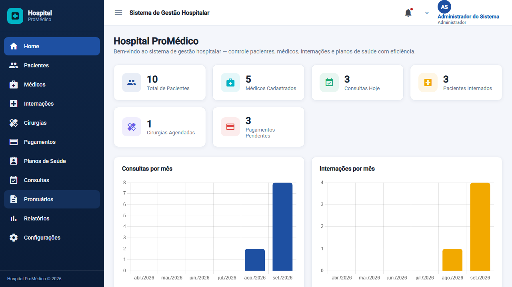
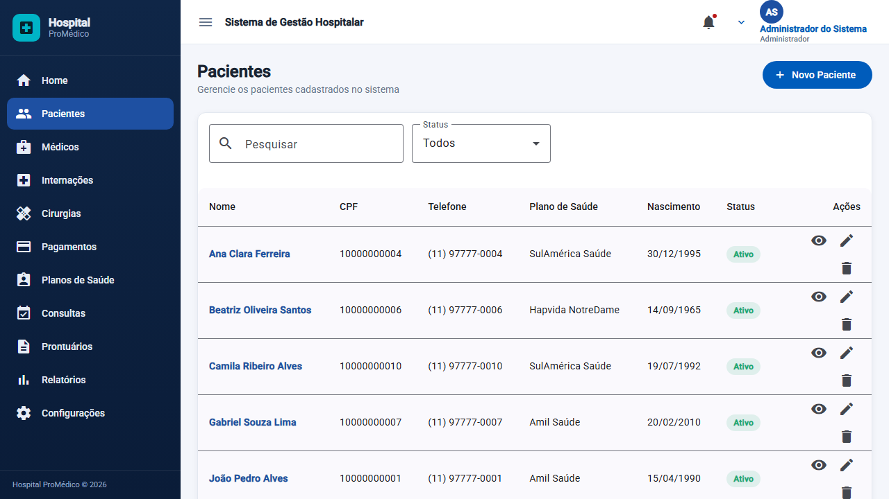
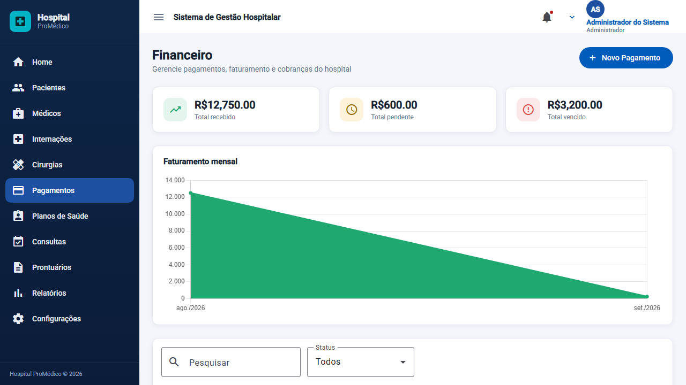

# Hospital ProMédico

Sistema completo de gestão hospitalar, com backend em **.NET 9 Web API** e frontend em **Angular 19**. Permite administrar pacientes, médicos, internações, cirurgias, planos de saúde, consultas, prontuários, pagamentos, relatórios e usuários, com autenticação JWT e controle de acesso por perfil.






## Tecnologias

**Backend**
- .NET 9 / ASP.NET Core Web API
- Entity Framework Core 9 (Code First) + SQLite
- JWT Bearer Authentication
- FluentValidation
- Swagger / OpenAPI
- BCrypt.Net (hash de senhas)
- xUnit (testes unitários)

**Frontend**
- Angular 19 (standalone components, signals)
- TypeScript
- Angular Material
- Reactive Forms
- Angular Router com Guards funcionais
- HttpClient com Interceptors funcionais (JWT + tratamento de erros)
- Chart.js (gráficos do dashboard e financeiro)
- jsPDF / jsPDF-AutoTable e SheetJS (xlsx) para exportação de relatórios

## Arquitetura

### Backend — Clean Architecture

```
backend/
├── HospitalProMedico.API              # Controllers, Middleware, Program.cs, DI
├── HospitalProMedico.Application      # DTOs, Services, Interfaces, Validators, Mappings
├── HospitalProMedico.Domain           # Entities, Enums, Interfaces (IRepository<T>)
├── HospitalProMedico.Infrastructure   # DbContext, Repository<T>, Seed, JWT/Hash services
└── HospitalProMedico.Tests            # Testes unitários (xUnit)
```

- **Repository Pattern** genérico (`IRepository<T>` / `Repository<T>`) sobre o `AppDbContext`.
- **Service Layer** concentra toda a regra de negócio (nada de lógica nos Controllers).
- **DTOs** dedicados para cada operação (Create/Update/List/Detail), sem expor entidades do domínio.
- **FluentValidation** validando automaticamente todo `[ApiController]` via um `IAsyncActionFilter` global (`ValidationActionFilter`), reduzindo boilerplate nos controllers.
- **Middleware de exceções global** (`ExceptionHandlingMiddleware`) mapeia exceções de negócio para códigos HTTP corretos (400/401/404/500) com corpo padronizado.
- **JWT** com claims de `role`, validado via `Microsoft.AspNetCore.Authentication.JwtBearer`; autorização por perfil usando `[Authorize(Roles = "...")]`.

### Frontend — Angular standalone + lazy loading

```
frontend/src/app/
├── core/
│   ├── guards/          # authGuard, roleGuard (funcionais)
│   ├── interceptors/    # jwtInterceptor, errorInterceptor (funcionais)
│   ├── models/          # Interfaces/enums espelhando os DTOs da API
│   └── services/        # Um serviço HTTP por recurso (Patient, Doctor, ...)
├── shared/
│   ├── components/      # confirm-dialog, page-header, empty-state, status-badge, chart
│   └── utils/           # helpers (labels de enum, variantes de badge)
├── layout/
│   ├── sidebar/  header/  shell/
└── features/
    ├── auth/ dashboard/ patients/ doctors/ appointments/
    ├── hospitalizations/ surgeries/ health-plans/
    ├── payments/ medical-records/ reports/ settings/
```

Cada módulo de feature possui suas próprias rotas (`*.routes.ts`), páginas, e consome os serviços do `core`. Todas as rotas de feature são carregadas via `loadChildren`/`loadComponent` (lazy loading).

## Perfis de acesso

| Perfil       | Acesso                                                             |
|--------------|---------------------------------------------------------------------|
| ADMIN        | Acesso completo a todos os módulos                                  |
| MEDICO       | Consultas, internações, cirurgias, prontuários (leitura/gestão clínica) |
| RECEPCAO     | Pacientes, consultas, internações, cirurgias (agendamento/cadastro) |
| FINANCEIRO   | Pagamentos e planos de saúde                                         |

## Requisitos

- [.NET SDK 9.0](https://dotnet.microsoft.com/download) (o repositório fixa a versão via `backend/global.json`)
- [Node.js 20+](https://nodejs.org/) e npm
- Angular CLI (`npm i -g @angular/cli`) — opcional, pode-se usar `npx ng`

## Como executar o Backend

```bash
cd backend

# Restaurar pacotes e aplicar migrations (criadas automaticamente no primeiro start)
dotnet restore

# Rodar a API (a migration e o seed de dados são aplicados automaticamente no startup)
dotnet run --project HospitalProMedico.API --urls http://localhost:5250
```

A API sobe em `http://localhost:5250`, com Swagger disponível em `http://localhost:5250/swagger` (ambiente Development).

O banco SQLite (`hospitalpromedico.db`) é criado automaticamente na pasta `HospitalProMedico.API` na primeira execução, já populado com dados de demonstração.

### Migrations (caso precise recriar)

```bash
cd backend
dotnet tool install --global dotnet-ef   # se ainda não tiver
dotnet ef migrations add NomeDaMigration --project HospitalProMedico.Infrastructure --startup-project HospitalProMedico.API --output-dir Data/Migrations
dotnet ef database update --project HospitalProMedico.Infrastructure --startup-project HospitalProMedico.API
```

### Executar os testes

```bash
cd backend
dotnet test
```

## Como executar o Frontend

```bash
cd frontend
npm install
npx ng serve --port 4200
```

Acesse `http://localhost:4200`. O frontend já está configurado (`src/environments/environment.ts`) para consumir a API em `http://localhost:5250/api`.

> CORS já está liberado no backend para `http://localhost:4200` (`appsettings.json` → `Cors:AllowedOrigins`).

## Usuário de demonstração

| Perfil      | Email                                | Senha           |
|-------------|---------------------------------------|-----------------|
| ADMIN       | admin@hospital.com                    | Admin@123       |
| MEDICO      | carlos.souza@hospitalpromedico.com.br | Medico@123      |
| RECEPCAO    | recepcao@hospitalpromedico.com.br     | Recepcao@123    |
| FINANCEIRO  | financeiro@hospitalpromedico.com.br   | Financeiro@123  |

As senhas são armazenadas com hash **BCrypt** (nunca em texto puro).

O seed inicial cria: 1 hospital, 5 planos de saúde, 5 médicos, 10 pacientes, 10 consultas, 5 internações, 3 cirurgias, 5 pagamentos, 10 prontuários e notificações de exemplo.

### Tela de registro (auto-cadastro)

Além do login, o sistema possui uma tela de **cadastro** (`/register`, com link "Cadastre-se" na tela de login) que permite a criação de uma nova conta com nome, email e senha. Contas criadas por essa tela recebem automaticamente o perfil **RECEPCAO** (perfil de menor privilégio) e o login é feito automaticamente após o cadastro. Perfis com mais privilégio (ADMIN, MEDICO, FINANCEIRO) continuam sendo atribuídos apenas por um ADMIN em Configurações → Usuários e Permissões.

## Principais endpoints

```
POST   /api/auth/login
POST   /api/auth/register

GET    /api/patients                GET /api/patients/{id}/details
POST   /api/patients                PUT /api/patients/{id}          DELETE /api/patients/{id}

GET    /api/doctors                 POST /api/doctors                PUT /api/doctors/{id}

GET    /api/appointments            POST /api/appointments           PATCH /api/appointments/{id}/status

GET    /api/hospitalizations        GET /api/hospitalizations/current

GET    /api/surgeries               POST /api/surgeries

GET    /api/health-plans            POST /api/health-plans

GET    /api/payments                GET /api/payments/summary

GET    /api/medical-records         POST /api/medical-records

GET    /api/dashboard
GET    /api/reports?startDate=...&endDate=...

GET    /api/settings/hospital       PUT /api/settings/hospital
GET    /api/users                   POST /api/users

GET    /api/notifications           PATCH /api/notifications/{id}/read
```

Todos os endpoints (exceto `/api/auth/login`) exigem `Authorization: Bearer {token}`.

## Segurança

- Tokens JWT assinados com HMAC-SHA256, expiração configurável (`Jwt:ExpirationMinutes` em `appsettings.json`).
- Senhas com hash BCrypt (work factor 11).
- Guards de rota (`authGuard`) e de perfil (`roleGuard`) no Angular; interceptor JWT injeta o token automaticamente e redireciona para `/login` em caso de 401/expiração.
- Tratamento global de exceções no backend, sem vazamento de stack traces para o cliente.

## Observações de projeto

- O SQLite foi escolhido conforme especificação, adequado para demonstração; para produção recomenda-se migrar para SQL Server/PostgreSQL (a troca é apenas de provider no `AddDbContext`).
- O token JWT é armazenado no `localStorage` do navegador para simplicidade de demonstração.
